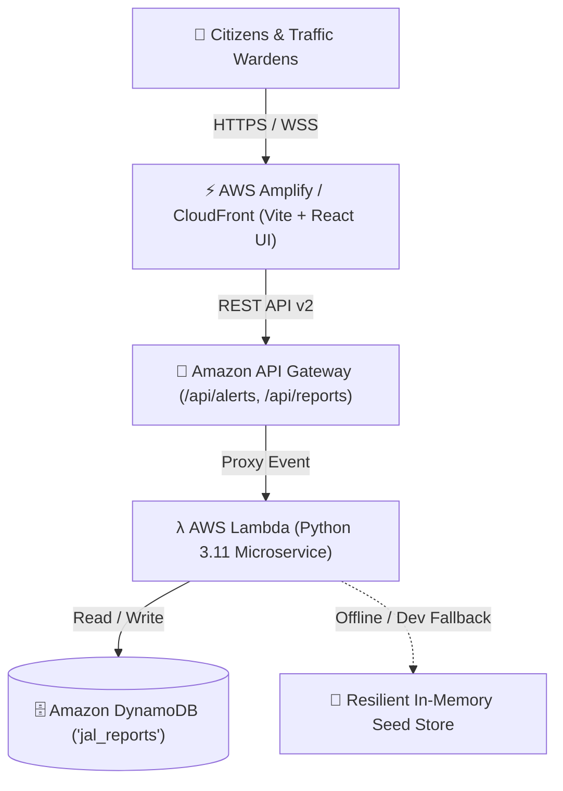
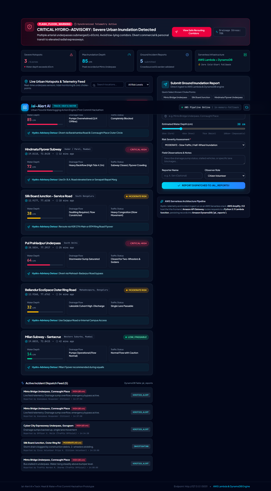

# 🌊 Jal-Alert AI: Urban Flood & Waterlogging Action Engine

> **Track**: Heat & Water | **Hackathon**: First Commit Hackathon  
> **Architecture**: Full-Stack AWS Serverless (Amplify / Vite React + API Gateway + Lambda Python 3.11 + DynamoDB)

---

## 📌 1. Problem Statement

Rapid urbanization and climate-induced cloudbursts frequently overwhelm stormwater drainage infrastructure across major Indian metropolitan hubs (such as Delhi NCR, Mumbai, and Bengaluru). Key transit bottlenecks—particularly railway underpasses, arterial ring road sumps, and low-lying subways—experience rapid inundation within minutes, leading to:
- **Severe Transit Gridlock**: Commuter entrapment, stalled buses, and submerged two-wheelers.
- **Critical Dispatch Latency**: Municipal pumping crews and traffic wardens receive delayed reports without real-time depth telemetry.
- **Absence of Actionable Rerouting**: Navigation tools often lack real-time hyper-local water depth data, guiding vehicles into flooded corridors.

**Jal-Alert AI** solves this by unifying **sensor telemetry**, **crowdsourced citizen ground reports**, and **automated hydro-advisories** with real-time safe detour rerouting powered by a resilient **AWS Serverless backend**.

---

## 🏗️ 2. AWS Serverless Architecture

Jal-Alert AI is designed from the ground up for zero idle cost, elastic auto-scaling during monsoon rainfall peaks, and multi-tier resilience:



### Serverless Building Blocks
1. **Frontend Hosting (AWS Amplify / CloudFront + S3)**:
   - Ultra-fast single-page application built with React 19, Vite, Tailwind CSS, and Lucide React.
   - High-contrast Emergency Operations Center (EOC) UI for rapid field readability.
2. **API Layer (Amazon API Gateway)**:
   - Serverless HTTP API v2 with CORS preflight and low-latency payload routing.
3. **Compute Layer (AWS Lambda - Python 3.11)**:
   - Microservice executing `backend/lambda_function.py`.
   - Handles `GET` (aggregating real-time monitored hotspots, risk metrics, and reports) and `POST` (validating citizen reports and persisting telemetry).
   - **Resilient Seed Store Fallback**: Automatically activates if DynamoDB credentials or network are offline, guaranteeing zero-downtime demonstration.
4. **Data Persistence (Amazon DynamoDB)**:
   - High-throughput NoSQL table named `jal_reports`.
   - Partition Key: `report_id` (String UUID).
   - Stores GPS coordinates, water depth (cm), severity classification, and observer metadata.

---

## ✨ 3. Core Features

| Feature | Description |
| :--- | :--- |
| **🚨 Actionable Hydro-Advisory Banner** | Computes urban drainage stress index and triggers dynamic advisories with safe rerouting recommendations based on live severity. |
| **📍 Live Waterlogging Hotspots Stream** | Real-time monitoring cards showing risk badges (`CRITICAL HIGH`, `MODERATE RISK`, `LOW/PASSABLE`), water depth gauges (cm), GPS coordinates, and diversion routes. |
| **📝 Ground Incident Reporting Portal** | Dispatch form allowing citizens and traffic officials to submit waterlogging observations with quick choke-point presets and depth sliders. |
| **⚡ Active Incident Dispatch Feed** | Instant display of verified alerts and investigating reports directly queried from DynamoDB. |
| **🔍 Search & Multi-Level Filtering** | Filter hotspots by severity or search by arterial landmarks and zones. |

---

## 📸 4. UI Walkthrough Preview

Below is the verified production UI dashboard running live with the active incident feed:



---

## 🚀 5. Local Setup & Quickstart

### Prerequisites
- **Node.js** (v18+ or v20+)
- **Python** (3.10+ or 3.11+)

### Clone and Configure
```bash
git clone https://github.com/your-username/2026-10_jal-alert.git
cd 2026-10_jal-alert
```

### Environment Variables
Configure your `.env` file in the root directory (see `.env.example`):
```env
# Local Mock Server (Default for local development)
VITE_API_URL=http://127.0.0.1:5001

# Production AWS API Gateway (When deployed to AWS):
# VITE_API_URL=https://<api-id>.execute-api.<region>.amazonaws.com/prod
```

### 1. Start the Local Python Backend
The included mock server (`backend/mock_server.py`) wraps `backend/lambda_function.py` and translates HTTP requests into AWS API Gateway events:
```bash
python backend/mock_server.py
```
> Running on `http://127.0.0.1:5001` (Endpoints: `GET /api/alerts`, `POST /api/reports`)

### 2. Start the Frontend Dev Server
In a separate terminal:
```bash
npm install
npm run dev
```
> Open your browser at `http://localhost:5173/`

### 3. Production Build Validation
```bash
npm run build
```

---

## 🧪 6. Testing & Verification

### Automated Pipeline Verification
Run the end-to-end API verification script to simulate report submission and feed retrieval:
```bash
python -c "import urllib.request, json; post_data = json.dumps({'location': 'Cyber City Expressway Underpass', 'estimated_depth_cm': 65, 'severity': 'HIGH'}).encode('utf-8'); req = urllib.request.Request('http://127.0.0.1:5001/api/reports', data=post_data, headers={'Content-Type': 'application/json'}); res = urllib.request.urlopen(req); print('POST Status:', res.status); alerts = urllib.request.urlopen('http://127.0.0.1:5001/api/alerts'); print('Alerts:', json.loads(alerts.read().decode('utf-8'))['status'])"
```

### Headless UI Walkthrough Verification
To execute the automated headless browser walkthrough:
```bash
node scripts/verify_ui.cjs
```
This script navigates to `http://localhost:5173`, interacts with the form presets, dispatches an incident report, and captures `jal_alert_walkthrough.png`.

---

## ⚙️ 7. AWS Deployment Guide

### Deploying the Backend
1. **Create DynamoDB Table**:
   - Table Name: `jal_reports`
   - Primary Key: `report_id` (String)
2. **Package & Deploy Lambda**:
   - Runtime: Python 3.11
   - Handler: `lambda_function.lambda_handler`
   - Environment Variables:
     - `DYNAMODB_TABLE=jal_reports`
     - `AWS_REGION=ap-south-1`
   - Attach IAM policy with `dynamodb:PutItem`, `dynamodb:Scan`, `dynamodb:GetItem`.
3. **Configure API Gateway**:
   - Create HTTP API with `ANY /api/{proxy+}` route pointing to the Lambda function.
   - Enable CORS with allowed origins `*`, methods `GET, POST, OPTIONS`.

### Deploying the Frontend
1. Run `npm run build` to generate the production bundle in `dist/`.
2. Connect the Git repository to **AWS Amplify Console** or deploy the `dist/` directory directly to an **Amazon S3** bucket fronted by **Amazon CloudFront**.
3. Set `VITE_API_URL` to your API Gateway invoke URL in the Amplify environment variables.

---

## 👥 Hackathon Team & Acknowledgements
- **Track**: Heat & Water (Urban Flood Resilience)
- **Engine**: Jal-Alert AI Serverless Action Engine
